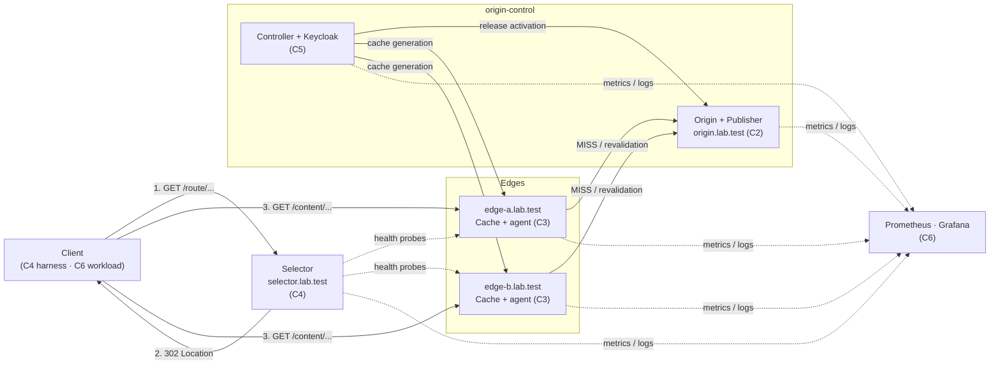
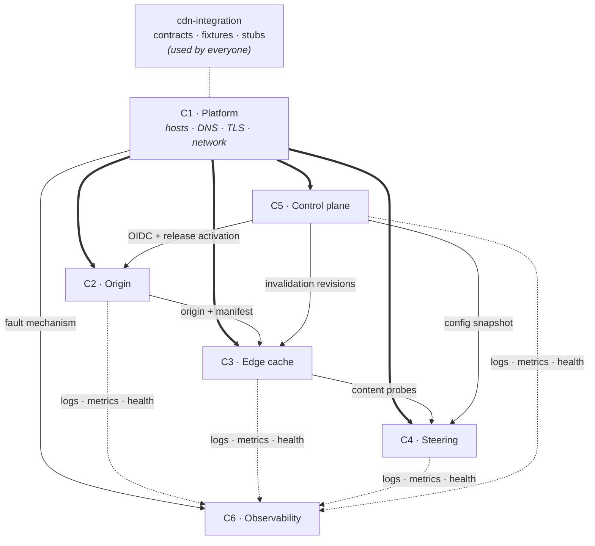

<div align="center">

# IF26 · CDN CampusCloud

**A laboratory Content Delivery Network (CDN), built collaboratively by the class project groups**

`1 origin` · `2 edge PoPs` · `2 tenants` · `6 components`

</div>

---

## Table of Contents

1. [Introduction](#1-introduction)
2. [Architecture and Topology](#2-architecture-and-topology)
3. [General Project Rules](#3-general-project-rules)
4. [Organization Repositories](#4-organization-repositories)
5. [Required Repository Structure](#5-required-repository-structure)
6. [Teams and Owners](#6-teams-and-owners)
7. [Component Summaries](#7-component-summaries)
8. [Cross-Repository Dependencies](#8-cross-repository-dependencies)
9. [Shared Contracts](#9-shared-contracts)
10. [Shared HTTP Correctness Test Matrix](#10-shared-http-correctness-test-matrix)

---

## 1. Introduction

This organization hosts all code, configuration and documentation for the **CDN CampusCloud** project, developed for the **IF26** course.

The goal is to jointly build **one small, measurable and reproducible system** that demonstrates how a real CDN works: an authoritative origin publishes content for two independent tenants (`alpha` and `beta`); two points of presence (PoPs) cache that content with HTTP correctness; a selector steers each client to a healthy PoP; a secure control plane manages publication and invalidation; and an observability layer produces experimental evidence about performance and resilience under failure.

The project is split into **six activities (C1 to C6)**. Each activity is developed by a pair of students and lives in **its own repository** within this organization. Integration between repositories happens exclusively through the **shared contracts** described in [section 9](#9-shared-contracts) and versioned in the [`cdn-integration`](#4-organization-repositories) repository.

---

## 2. Architecture and Topology

### 2.1 Overview



All infrastructure (VMs, networking, DNS, certificates, network profiles) is provided by **C1**.

### 2.2 Lab Nodes

| Node | Services | Owner |
|---|---|---|
| `origin-control` | Origin HTTP server and publisher; controller and identity; telemetry if capacity allows | C2, C5 and C6 on the C1 platform |
| `edge-a` | Edge cache, local generation agent and content probe | C3 on the C1 platform |
| `edge-b` | Independent edge instance with its own cache directory | C3 on the C1 platform |
| `client` | Selector tests, workload driver and hash validation | C4 and C6 |
| `selector` | May run on `origin-control` with a declared availability limit | C4 |

### 2.3 Minimum Boundary Decisions

| Boundary | Minimum decision |
|---|---|
| Content | Public, deterministic files for two tenants |
| Sites | One origin and two logical edge PoPs |
| Transport | HTTPS for clients and protected control APIs |
| Cache | Full objects only; range traffic passes through |
| Steering | HTTP redirect with a healthy fallback |
| Updates | Immutable releases plus a short-lived mutable manifest |

---

## 3. General Project Rules

The following rules apply to **every repository and every group**, without exception.

### 3.1 Common Technology Stack

| Area | Baseline choice |
|---|---|
| Operating system | Linux VMs |
| Automation | Ansible |
| Container runtime | Podman **or** Docker (**a single runtime for the whole class**, decided by C1) |
| Origin and edges | NGINX open source |
| Application services | Python + FastAPI |
| Identity | Keycloak (OIDC) |
| State / metadata | SQLite |
| Observability | Prometheus + Grafana |

The alternatives listed in the technical guide are allowed **as long as they preserve the same contracts and workload**. Each component implements **only one** route. Reuse mature protocol implementations and develop the adapters, policies and tests that connect them.

**Extensions** (the "bounded extension" of each component, or an HTTP/3 comparison) may only start **after all minimum checks of that component pass**, and must fit inside the same hour budget.

### 3.2 Versions and Dependencies

- Use **supported releases available at course start**.
- Record exact package versions or image digests and keep a **lock file** in every repository.
- **Floating tags** (`latest`, `stable`, etc.) **are not allowed** in the submission.
- Confirm module and licence availability before choosing features (e.g. `proxy_cache_purge` **does not exist** in NGINX open source).

### 3.3 Names, Networking and Addressing

- DNS names: `selector.lab.test`, `origin.lab.test`, `edge-a.lab.test`, `edge-b.lab.test`.
- Content namespaces on both edges: `/content/alpha/` and `/content/beta/`.
- C1 reserves unique **management** and **delivery** subnets. **No application may hardcode IP addresses** — use DNS names or deployment variables.
- Keep clocks synchronised on all nodes (certificates, tokens and timestamps depend on it).

### 3.4 Security

- TLS on every service, using certificates signed by a **laboratory CA** trusted by the clients. **Never disable certificate validation.**
- Administrative ports bind only to management addresses and are protected by allowlists.
- Always verify token signature, issuer, expiry, audience and tenant role. Accepted algorithms are defined explicitly.
- **Never** send publisher or operator credentials to public delivery URLs.
- **Never** log bearer tokens, cookies or uploaded secrets — log only request identifiers and outcomes.
- Secrets live in an environment file **excluded from Git** (`.env`); every repository ships a safe `.env.example`.

### 3.5 Common HTTP Error Codes

| Code | Usage |
|---|---|
| `400` | Malformed input |
| `401` | Missing or invalid authentication |
| `403` | Valid credentials without permission |
| `404` | Unknown resource |
| `409` | Revision conflict or attempt to write to an immutable path |
| `503` | No healthy delivery option available |

### 3.6 Health and Observability (mandatory for every service)

- `GET /healthz` — the process is alive (liveness).
- `GET /readyz` — dependencies are ready (readiness). **These are distinct endpoints.**
- `GET /metrics` or a documented structured JSON log, consumed by C6.
- Metric labels limited to `service`, `pop`, `tenant`, `outcome` and a bounded object class (controlled cardinality).

### 3.7 Resources and Limits

- Pilot with **3 VMs of 4 vCPU / 8 GiB RAM / 60 GiB disk**, plus a client and separate backup storage.
- Total dataset **< 25 MiB**; individual objects **< 10 MiB**; telemetry retention of a few days.
- Measure memory and disk usage before increasing traffic.
- Separate cache directories and processes, even when two VMs share hardware (label such a topology as an emulation).
- **State and backups:** origin content and controller metadata must be backed up to the separate backup storage; cache files are disposable and are **never** a durability mechanism (caches are rebuilt, not restored).

### 3.8 Workload and Roles

- Each pair has **120 person-hours (60 h per student)**, including reading, implementation, integration, meetings, testing and the final demonstration.
- Initial leads (see [section 6](#6-teams-and-owners)) are organisational responsibilities, **not isolated ownership**.
- **Both students** contribute code or configuration, automated checks and a runbook. A documentation-only or testing-only role **does not meet** the assignment.
- At **32 hours** per student, partners swap operator and reviewer roles: **each student must be able to deploy or recover the part initially led by their partner**.
- Progress checkpoints at **14 h** and **32 h**. If behind schedule, drop optional features, custom web interfaces and extra software stacks first — **never** the core tests.
- Each student keeps an **individual time log**, reviewed commits and a short statement of technical decisions.
- Simplicity principle: **one script, one service and one schema** wherever these meet the requirement.

---

## 4. Organization Repositories

| Repository | Component | Description |
|---|---|---|
| [`.github`](https://github.com/IF26-CDN-CampusCloud/.github) | Organization | This README, issue/PR templates and shared community files (CONTRIBUTING, CODE_OF_CONDUCT) |
| [`cdn-integration`](https://github.com/IF26-CDN-CampusCloud/cdn-integration) | Integration | Contracts (OpenAPI / JSON Schema), fixtures, stubs, joint deployment and integration tests |
| [`cdn-c1-platform`](https://github.com/IF26-CDN-CampusCloud/cdn-c1-platform) | **C1** | PoP platform and network emulation |
| [`cdn-c2-origin`](https://github.com/IF26-CDN-CampusCloud/cdn-c2-origin) | **C2** | Origin and content publication |
| [`cdn-c3-edge-cache`](https://github.com/IF26-CDN-CampusCloud/cdn-c3-edge-cache) | **C3** | Edge caching and HTTP correctness |
| [`cdn-c4-steering`](https://github.com/IF26-CDN-CampusCloud/cdn-c4-steering) | **C4** | Request steering and health |
| [`cdn-c5-control-plane`](https://github.com/IF26-CDN-CampusCloud/cdn-c5-control-plane) | **C5** | Secure lifecycle and control plane |
| [`cdn-c6-observability`](https://github.com/IF26-CDN-CampusCloud/cdn-c6-observability) | **C6** | Observability and resilience experiments |

**Naming convention:** `cdn-c<N>-<component>`, lowercase, words separated by hyphens. The `cdn-c<N>` prefix keeps repositories sorted and instantly identifiable.

---

## 5. Required Repository Structure

All component repositories (`cdn-c1` to `cdn-c6`) follow the same base structure. Folders may be adapted to the nature of the component (e.g. C1 uses `ansible/` instead of `src/`), but **files marked with ★ are mandatory**.

```text
cdn-cN-<component>/
├── README.md                 ★ Purpose, architecture, how to run, exposed and consumed interfaces
├── RUNBOOK.md                ★ Deploy, verify, recover and troubleshoot (step by step)
├── CHANGELOG.md              ★ Changes per version (Keep a Changelog format)
├── Makefile                  ★ Targets: deploy, smoke, test, demo, cleanup
├── .env.example              ★ Required variables, no real secrets
├── .gitignore                ★ Excludes .env, keys, caches and build artefacts
├── versions.lock             ★ Exact versions / image digests (or requirements.lock, etc.)
├── .github/
│   ├── CODEOWNERS            ★ Both members of the pair
│   ├── pull_request_template.md
│   └── workflows/
│       └── ci.yml            ★ Formatting, lint, config validation and contract tests
├── src/                      Service source code (or ansible/, nginx/, analysis/…)
├── config/                   Versioned configuration (no secrets)
├── deploy/                   Container/systemd templates, health checks, resource limits
├── tests/
│   ├── unit/                 Unit tests
│   └── contract/           ★ Tests against the contracts defined in cdn-integration
└── docs/
    ├── decisions.md        ★ Technical decisions and rejected alternatives (short ADR format)
    ├── evidence/             Results, captures and logs proving the acceptance criteria
    └── timelog/
        ├── <student1>.md     ★ Individual time log
        └── <student2>.md     ★
```

### 5.1 Mandatory `Makefile` Targets

| Target | Purpose |
|---|---|
| `make deploy` | Install/update the component on the nodes provided by C1 |
| `make smoke` | Quick check (health, connectivity, TLS) |
| `make test` | Unit tests + contract tests |
| `make demo` | Run the component's demonstration scenario |
| `make cleanup` | Remove created resources and restore the initial state |

### 5.2 The `cdn-integration` Repository

```text
cdn-integration/
├── README.md
├── contracts/
│   ├── openapi/              publisher, route, invalidations, agent
│   └── schemas/              manifest.schema.json, invalidation.schema.json, export-event.schema.json
├── fixtures/                 Reference SHA256 hashes and shared test files
├── stubs/                    Minimal stubs to keep working when another team is late
├── deployment/               Joint orchestration (inventory, variables, deploy order)
├── integration-tests/        End-to-end tests for the HTTP correctness matrix (section 10)
└── Makefile                  deploy, smoke, test, demo, cleanup (full system)
```

Any change under `contracts/` requires **approval from at least one member of every team that consumes** that contract.

---

## 6. Teams and Owners

| Repository | Student 1 | Student 1 initial lead | Student 2 | Student 2 initial lead |
|---|---|---|---|---|
| `cdn-c1-platform` | João Viegas | Provisioning, images and deployment automation | Pedro Melo | Network profiles, certificate trust and rebuild tests |
| `cdn-c2-origin` | Tiago Melo | Content server, dataset generator and HTTP fixtures | Bruno Marques | Publisher API, authorisation integration and restore drill |
| `cdn-c3-edge-cache` | Simão Almeida | Cache policy, keys, validators and variant tests | Bernardo Marujo | Generation agent, coalescing and failure behaviour |
| `cdn-c4-steering` | Oli | Selection algorithm, redirect API and input validation | Josep | Health state, client retry harness and failover timing |
| `cdn-c5-control-plane` | Martim Carvalho  | OIDC integration, tenant policy and authorisation tests | Gabriel Janicas | Lifecycle state machine, invalidation acknowledgements and audit |
| `cdn-c6-observability` | Diogo Silva | Instrumentation, dashboards and byte accounting | Duarte Santos | Workload harness, fault experiments and result analysis |
| `cdn-integration` | ------  | Contract maintenance and integration tests | — | — |

---

## 7. Component Summaries

### C1 — PoP platform and network emulation · `cdn-c1-platform`

**Goal:** provide reproducible hosts, network conditions and deployment templates for the origin and the two PoPs.

- Automates three Linux nodes (`origin-control`, `edge-a`, `edge-b`), a separate client process and an isolated management path.
- Publishes addressing, DNS names and laboratory CA certificates; owns certificate distribution.
- Supplies container/systemd templates with health checks, persistent volumes, resource limits and pinned versions.
- Creates named network profiles (local delivery and emulated WAN) and a time-bounded fault mechanism with automatic cleanup, **never affecting the management connection**.
- **To develop:** inventory, reusable deployment role, profile switcher and rebuild smoke tests.
- **Acceptance:** a partner rebuilds `edge-b` from the runbook, retrieves an origin object over verified TLS and reproduces the declared latency profile; removing a fault restores the baseline.
- **Recommended:** Ansible + Podman/Docker on three VMs (alternative: K3s).
- **Extension:** compare resource limits or add IPv6 on the existing topology.

### C2 — Origin and content publication · `cdn-c2-origin`

**Goal:** authoritative content, reproducible datasets and a safe publication workflow for two independent publishers.

- Serves **≥ 50 deterministic public objects** (tenants `alpha` and `beta`) on immutable release paths, with a SHA256 manifest and `Cache-Control: public, max-age=3600`.
- Maintains a mutable `current.json` release manifest with a 5-second freshness lifetime.
- Authenticated upload and release activation, atomic writes, path validation and quotas; rejects overwrites of immutable paths.
- Supports GET, HEAD, validators, conditional requests and byte ranges (in the mature HTTP server); provides fixtures for query variants, `Vary`, `private`, `no-store` and cookie-bearing responses.
- Backs up content and metadata and performs at least one verified restore.
- **Acceptance:** both tenants publish and retrieve correct hashes; `alpha` cannot change `beta`; an immutable overwrite fails; restored files match the manifest.
- **Recommended:** NGINX static origin + FastAPI publisher + SQLite.
- **Extension:** serve pre-generated HLS video segments as some public objects (encoding, live streaming and DRM are out of scope).

### C3 — Edge caching and HTTP correctness · `cdn-c3-edge-cache`

**Goal:** an HTTP cache at each PoP whose responses remain correct and isolated.

- Caches eligible full GET/HEAD responses; the cache key includes the approved host, the full URI (including query) and the **invalidation generation**.
- Honours `Vary`, `private`, `no-store`, `Set-Cookie` and `Vary: *`; bypasses authenticated and range requests.
- Tests freshness expiry, conditional revalidation, request coalescing and a bounded `stale-if-error` on one public fixture (`max-age=5, stale-if-error=10`, keeping `proxy_cache_use_stale` at its default).
- Caches only full `200` responses in the baseline; `206` responses are never stored.
- Exposes PoP and cache-status headers.
- A restricted local agent applies the requested generation, validates configuration (`nginx -t`) before reload and acknowledges the applied revision.
- **Acceptance:** the second eligible GET is a HIT with the expected hash; variants never mix; exclusions never get cached; both PoPs acknowledge a generation change.
- **Recommended:** NGINX open source with generation-based logical invalidation (alternative: Varnish).
- **Extension:** compare cache capacities or add a bounded `stale-while-revalidate` experiment.

### C4 — Request steering and health · `cdn-c4-steering`

**Goal:** select a healthy PoP for each new request and explain the limits of steering during failure.

- HTTPS selector that issues a `302` to an allowlisted edge, preserving the query string, with `Cache-Control: no-store`.
- Content probes against both PoPs and health state with hysteresis (proposed: probe every 2 s, 2 failures to remove, 2 successes to restore).
- Selection via a client-zone latency matrix **or** consistent hashing with a healthy fallback; caches the last valid catalogue locally.
- Client harness that follows redirects and, after a failed GET, asks the selector once more with bounded backoff.
- **Acceptance:** requests from two zones select the expected PoP; with one edge stopped, new requests move to the survivor within **≤ 6 s**; bad hosts and redirect targets are rejected.
- Specifies how ties, timeouts and an empty healthy set behave (`503` when no healthy PoP exists).
- **Recommended:** FastAPI selector with measured or configured zone latency (alternative: consistent hashing; DNS steering only as an extension).
- **Extension:** compare both selection algorithms using exactly the same workload and health traces.

### C5 — Secure lifecycle and control plane · `cdn-c5-control-plane`

**Goal:** control tenant publication and cache invalidation without placing administrative services in the public delivery path.

- Integrates Keycloak OIDC with publisher and operator roles scoped to `alpha` or `beta`.
- Stores versioned tenant and edge configuration, audits changes and coordinates C2 release activation with C3 logical invalidation.
- Uses `operation_id`, monotonic revisions and idempotent retry; exposes per-PoP status: `pending`, `partial`, `applied` or `failed`.
- **Never** reports completion while a required PoP is unreachable; **never** accepts arbitrary shell commands, filesystem paths or upstream URLs.
- **Acceptance:** invalid tokens fail; `alpha` cannot administer `beta`; repeating an operation creates no extra revision; a stopped edge yields `partial`; after recovery, both PoPs converge within **≤ 10 s**.
- Preserves and restores the last valid controller configuration; revisions stay monotonic after a restore.
- **Recommended:** FastAPI + SQLite + Keycloak (alternative: reviewed Git configuration feeding the same controller).
- **Extension:** a reviewed rollback plan, demonstrating rollback as a new revision that points to an earlier known release.

### C6 — Observability and resilience experiments · `cdn-c6-observability`

**Goal:** produce reproducible evidence about correctness, cache effectiveness and delivery behaviour under load and during controlled failures.

#### Observability

- Collects origin and edge logs plus bounded-cardinality service metrics.
- Dashboards for request outcomes, eligible cache hits, origin body bytes, latency and invalidation lag.
- Retains raw results and test configuration; defines a documented, append-only JSONL/CSV event export (with `run_id` and `phase` labels and documented duplicate/missing-event handling).

#### Load and performance tests

Compares **direct origin**, **cold cache** and **warm cache** under the same emulated WAN and the same workload.

| Setting | Baseline |
|---|---|
| Object mix | At least 50 objects, 256 B to 5 MiB, total below 25 MiB |
| Concurrency | 10 clients, aggregate **20 GET requests/s** |
| Run length | **120 s per phase**, **3 independent runs** |
| Traffic model | Fixed seed; same trace across direct, cold and warm paths |
| Network | Recorded WAN delay and bandwidth profile, plus a local profile |
| Integrity | SHA256 check of every completed full body |
| Warm state | Explicit warm-up, excluded from the reported steady-state window |
| Cold state | New release key or isolated disposable cache, with proof of emptiness |

#### Resilience and fault-injection (stress) tests

Four automated faults, each run **3 times with the same trace**, following a safe lifecycle: **120 s baseline → 60 s injection → 120 s recovery observation**.

| Fault | Action | Expected behaviour |
|---|---|---|
| **PoP failure** | Stop one edge for 60 s | New selections leave the failed edge within **6 s**; existing transfers may fail; client retry is bounded and visible |
| **Origin failure** | Stop the origin for 60 s | Fresh cached objects remain available; cold objects fail clearly; the short-lived public fixture stops serving stale content after its error window |
| **Control plane failure** | Stop administration for 60 s | Already configured public delivery continues; new publications and invalidations cannot complete and report their true state |
| **Origin latency** | Add 50 ms one-way delay on the isolated edge-to-origin path for 60 s | Compare hot and cold requests; quantify the impact of the extra delay |

- Every injection is **time-bounded** and uses C1's allowlisted targets with an automatic timeout.
- Cleanup uses `try/finally`, and the original network profile is verified **both after normal completion and after cancellation**.
- Recovery is reported in three separate steps: **failure detection**, **next client request rerouted**, and **final successful body delivery**.

#### Joint exercises

- **Partial invalidation (with C3 and C5):** stop `edge-b`, issue an invalidation and confirm `partial` status; bring `edge-b` back, replay the same operation and confirm both PoPs converge within **10 s** without claiming atomic global completion.
- **Recovery and durability (with C2 and C5):** restore origin files and metadata into an empty directory, verify all manifest hashes and activate the restored snapshot; restore controller state and confirm revision monotonicity; rebuild caches instead of restoring them.

#### Metrics (explicit denominators)

- **Cache hit ratio** = full eligible GET responses marked `HIT` ÷ all full eligible GET responses in the window. Other cache statuses are shown separately, with an all-request outcome count alongside.
- **Origin body byte offload** = 1 − (origin response body bytes ÷ edge response body bytes), for matched traffic in the same window, read from actual body-byte counters (not `upstream_bytes_received`). A zero denominator is reported as undefined; negative offload is investigated, never clamped.
- **Request offload** (if used) = 1 − (origin GET count ÷ eligible edge GET count).
- **Timing:** time to first byte, complete-object latency and failures, reported as **p50 and p95 per run** plus the spread across runs; selector time reported separately from end-to-end time (including redirects). Errors and timeouts stay visible.

#### Summary

- **To develop:** log adapters, correctness assertions, workload harness, fault scripts and analysis. Unexpected results must be explained, not just shown as screenshots.
- **Acceptance:** a fresh checkout reproduces one performance comparison and all four faults; reports include three runs, p50/p95, errors, bytes and hardware limits; every successful body matches its manifest and every fault has cleanup evidence.
- **Pitfalls:** a high hit ratio does not prove low origin byte traffic; a `304` is not a full body transfer; a short emulated run cannot support claims of annual SLA, energy savings or geographical resilience.
- **Recommended:** Prometheus, Grafana, HTTPX or Locust, Toxiproxy or isolated netem (alternative: structured logs + a Python analysis pipeline).
- **Extension:** evaluate a Zipf-like popularity distribution against uniform demand, keeping request rate and cache capacity fixed.

---

## 8. Cross-Repository Dependencies

### 8.1 Dependency Graph



*How to read it: an arrow `A → B` means "A provides something B depends on". Thick arrows from C1 represent the platform (hosts, DNS, TLS, network profiles); dashed arrows into C6 represent telemetry. Every repository depends on the contracts in `cdn-integration`.*

### 8.2 Dependency Matrix

| Repository | Consumes from | Provides to |
|---|---|---|
| **C1** Platform | — | **C2–C6:** hosts, addresses, DNS, certificates, network profiles, templates · **C6:** safe fault mechanism |
| **C2** Origin | **C1:** platform · **C5:** identity and calls to the activation API | **C3:** allowlisted origin, content and manifest · **C5:** activation API · **C6:** fixture hashes and access logs |
| **C3** Edge cache | **C1:** platform · **C2:** origin · **C5:** invalidation revisions | **C4:** content path for probes · **C5:** applied-revision acks · **C6:** request logs |
| **C4** Steering | **C1:** addresses and network profiles · **C3:** content probes · **C5:** configuration snapshot | **Clients:** `/route` · **C6:** detection and failover timings |
| **C5** Control plane | **C1:** platform · **C2:** atomic activation · **C3:** edge application and ack | **C2:** identity/authorisation · **C3:** desired generations · **C4:** configuration · **C6:** invalidation state |
| **C6** Observability | **C1:** fault mechanism · **C2–C5:** logs, fixtures, metrics and health endpoints | **Class:** reports, dashboards and event export |

### 8.3 Dependency Rules

1. **Dependencies are by contract, never by code.** No repository imports code from another; interaction happens over HTTP, configuration files or exports defined in `cdn-integration/contracts/`.
2. **When another team is late**, the others use the agreed stub and fixture hashes, log the missing capability (version and failing request) as an issue in that team's repository, and replay the same contract test against the real service as soon as it is available.
3. For the first checkpoint, the instructor provides a minimal origin, catalogue, and identity configuration.
4. Administrative outages (C5) **must not interrupt** delivery of already available public objects.

---

## 9. Shared Contracts

The contracts below are the **source of truth** for integration and are formalised in `cdn-integration/contracts/`.

| Interface | Owner | Minimum contract |
|---|---|---|
| `GET` / `HEAD /content/{tenant}/{release}/{path}` | C2 (origin) · C3 (edge) | Immutable bytes, content type and known SHA256 in a separate manifest |
| `GET /content/{tenant}/current.json` | C2 | Mutable release pointer; public, `max-age=5`; C3 caches it under its normal policy |
| `POST /publisher/v1/releases` | C2 | Authenticated upload or activation, tenant scope and expected revision |
| `GET /route/{tenant}/{release}/{path}` | C4 | `302 Location` to an allowlisted edge, query retained, `no-store` |
| `POST /admin/v1/invalidations` | C5 | Authenticated `operation_id`, `tenant`, `path` and monotonic revision |
| `GET /admin/v1/invalidations/{id}` | C5 | Overall status and per-PoP applied revision or error |
| `PUT /agent/v1/generations` | C3 | Private allowlisted input, expected revision, validated apply and acknowledgement |
| `GET /healthz` and `/readyz` | All | Distinct liveness and readiness |
| `GET /metrics` or structured JSON log | All | Bounded labels and documented fields, consumed by C6 |

<details>
<summary><b>Schema examples (manifest, invalidation, export)</b></summary>

**Content manifest (C2)**

```json
{"tenant":"alpha","release":"r1","revision":1,
 "objects":[{"path":"asset.bin","size_bytes":16384,
 "sha256":"<64 lowercase hexadecimal characters>",
 "content_type":"application/octet-stream"}]}
```

**Invalidation request and status (C5)**

```json
{"operation_id":"alpha-current-002","tenant":"alpha",
 "path":"/content/alpha/current.json",
 "expected_revision":1,"revision":2}
```

```json
{"operation_id":"alpha-current-002","status":"partial",
 "pops":{"edge-a":{"applied_revision":2},
         "edge-b":{"applied_revision":1,"error":"unreachable"}}}
```

**Export event (C6)**

```json
{"schema_version":1,"event_id":"edge-a-000123",
 "timestamp":"2026-10-22T12:00:00Z","pop":"edge-a",
 "tenant":"alpha","object":"r1/asset.bin",
 "status":200,"cache_status":"HIT","body_bytes":16384,
 "latency_ms":8.2,"client_zone":"zone-1"}
```

</details>

---

## 10. Shared HTTP Correctness Test Matrix

Every case below must be automated in `cdn-integration/integration-tests/` and pass at **both PoPs**. The whole class reviews this matrix before the first integration.

| Case | Expected observation | Main owners |
|---|---|---|
| Cold then warm full GET | `MISS` then `HIT` at each PoP, with the same known body hash | C3 |
| HEAD before and after GET | Correct headers and no body; HEAD never replaces a cached GET with an empty representation | C3 |
| Expiry with unchanged origin | Conditional revalidation at the origin; origin `304` kept separate from edge body delivery | C2 · C3 |
| Query and language variants | Distinct query values and `Vary: Accept-Language` fixtures keep their own body hashes | C2 · C3 |
| Tenant separation | Same basename in `alpha` and `beta` returns distinct expected bodies at both PoPs | C2 · C3 |
| Storage exclusions | `Authorization`, `private`, `no-store`, `Set-Cookie` and `Vary: *` never produce reusable shared-cache responses | C3 |
| Client cache directives | Request `no-cache` fetches or validates upstream; request `no-store` does not store the response | C3 |
| Ranges | A known byte interval returns a correct `206` and `Content-Range`; an unsatisfiable range returns `416`; range traffic bypasses storage | C2 · C3 |
| Concurrent cold requests | **20 parallel identical GETs produce at most 2 origin GETs per PoP** (fast-origin test; lock age, lock timeout and origin response time recorded) | C3 · C6 |
| Invalidation and retry | All variants use the new generation; repeated operation IDs are idempotent; stale revisions return `409` | C3 · C5 |
| Negative security cases | Path traversal, unknown host, open redirect, wrong audience and cross-tenant administration all fail | C2 · C4 · C5 |
| Bounded stale response | A public fixture may survive the declared short error window; once it expires, the system reports an error | C3 · C6 |

C2 supplies dynamic fixtures through a small fixture endpoint behind the origin wherever static files cannot express the required headers, and generates separate known hashes for each language representation.

---

<div align="center">
<sub>IF26 · CDN CampusCloud — maintained in the organization's <code>.github</code> repository.</sub>
</div>
